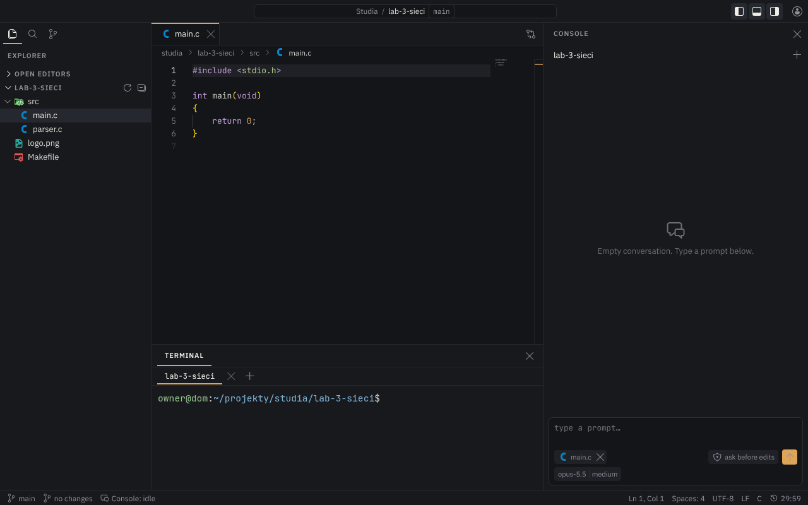

# Claushh

[](https://github.com/Zambrzyckii/Claushh/actions/workflows/ci.yml)
[](https://github.com/Zambrzyckii/Claushh/releases/latest)
[](LICENSE)




A private web portal for one user, for working on projects from any device. Everything happens in the browser, which
gives you a code editor, a console for Claude Code, a terminal and git on the projects that live on your own server,
behind Cloudflare Access and a Cloudflare Tunnel.

## What it does

* **Editor.** Monaco with tabs, saving with Ctrl+S, a diff view of the open file against HEAD, search in files, and
  file and folder icons from Material Icon Theme.
* **Console.** Claude Code conversations in their own panel. The model, the effort and the permission mode are chosen
  for each prompt, every step shows what was read, edited or run, and a permission question is answered with "yes",
  "yes, always" or "no".
* **Terminal.** Your login shell on tmux, so a terminal survives a page reload and reconnects without gaps.
* **Git.** Workspaces that group repositories, with cloning over https, status, pull and push, and a background fetch.
* **Security.** Login with a password and a TOTP code or with a passkey, a Security window with the active sessions and
  the login history, and a notification on the phone for every login.
* **Phone.** A layout with Editor, Terminal and Console tabs, the side bar as a drawer and an extra-keys row for the
  terminal.

## Tech stack

| Layer | Technology |
|---|---|
| Backend | ASP.NET Core on .NET 10, SignalR, ASP.NET Core Identity (TOTP, passkeys), EF Core with Npgsql, LibGit2Sharp and the git CLI |
| Database | PostgreSQL 17 in a container |
| Frontend | Angular 21, Monaco Editor, xterm.js, `@microsoft/signalr` |
| Console | the official `claude` CLI in headless mode (`--output-format stream-json`), one process per conversation |
| Terminal | tmux in control mode, no PTY package |
| Server | a Linux host with systemd, Podman for rootless containers in the terminal, Cloudflare Access and Cloudflare Tunnel in front |
| Tests | Vitest and Playwright for the frontend, xUnit with Testcontainers for the backend |

## Running in development

Requirements: Linux for the backend, .NET 10 SDK, Node.js 22.12+ (npm 11), Docker, git (the API runs it for clone,
fetch, pull and push), tmux 3.7 or later (the terminal; dotnet test needs it too), the `claude` CLI 2.1.285 or later
(the console; dotnet test does not need it).

```bash
# database (the compose project claushh-dev; the server uses claushh-prod)
cp deploy/.env.example deploy/.env    # fill in the password and a free POSTGRES_PORT
docker compose -p claushh-dev -f deploy/docker-compose.yml --env-file deploy/.env up -d

# backend: http://localhost:5080/api/health
dotnet user-secrets set --project src ConnectionStrings:Claushh \
  "Host=localhost;Port=<POSTGRES_PORT>;Database=claushh;Username=claushh;Password=<POSTGRES_PASSWORD from deploy/.env>"
dotnet user-secrets set --project src Projects:Root <directory>    # the projects directory of the portal
dotnet run --project src -- create-user    # once: the account and its TOTP key
dotnet run --project src

# frontend: http://localhost:4200
cd web
npm install
npm start
```

The details are in [docs/DEVELOPMENT.md](docs/DEVELOPMENT.md), "Running in development", which covers the terminal's
environment, the console's own `claude` login and config directory, the login notifications, passkeys at `localhost`,
and the `create-user` commands that give the account a new TOTP key or password.

## Running the built frontend

The API serves the production build itself when `Frontend:Root` points at it, as on the server (one process, one
origin):

```bash
npm --prefix web run build    # the build in web/dist/web/browser
dotnet user-secrets set --project src Frontend:Root <absolute path>/web/dist/web/browser
dotnet run --project src
```

Then open `http://localhost:5080`, which is already one of the hubs' allowed origins (`appsettings.Development.json`).
The API takes the Content-Security-Policy header from `index.html` once at start, so restart it after a build that
changes the policy. Without `Frontend:Root` the API serves no frontend, and development uses `npm start` as above.

## Deployment

The portal runs as a systemd service on a Linux server of your own, with PostgreSQL in a container next to it and
Cloudflare Access and a Cloudflare Tunnel in front, so no port is open to the internet.
[docs/DEPLOYMENT.md](docs/DEPLOYMENT.md) has the first install step by step, the checks before and after the tunnel,
updates, rollback and restoring a dump. Each release on GitHub also carries the build as `claushh-<tag>-linux-x64.tar.gz`
and as the package `ghcr.io/zambrzyckii/claushh` (DEPLOYMENT.md, "Updates").

## Tests

`npm test` in `web/` runs the frontend's integration tests (Vitest), and `npm run e2e` builds the app and runs the
Playwright tests on the mock backend in `web/e2e/mock-api/`. `dotnet test` runs the backend's integration tests and
needs Docker. CI runs the frontend's tests on every pull request and every push to `main`. The details, such as the
Node flag the npm scripts set, are in [docs/DEVELOPMENT.md](docs/DEVELOPMENT.md), "Frontend tests" and "Backend tests".

## Documentation

| File | About |
|---|---|
| [`docs/DEVELOPMENT.md`](docs/DEVELOPMENT.md) | running in development, the built frontend, the tests, updating the file icons |
| [`docs/DEPLOYMENT.md`](docs/DEPLOYMENT.md) | the install on the server, the checks before and after the tunnel, updates, rollback, restoring a dump |
| [`docs/ARCHITECTURE.md`](docs/ARCHITECTURE.md) | current code map, endpoints, conventions, tests |
| [`docs/PLAN.md`](docs/PLAN.md) | goal, interface, stack, security, deployment, stages |
| [`CLAUDE.md`](CLAUDE.md) | working rules for the repository (also for Claude Code) |

## License

The project's own code is under the [MIT License](LICENSE). The third-party files below keep their own licenses and
are not covered by it. These are the icons in `web/public/file-icons/` and the name map generated from them,
`web/src/app/core/icons/file-icon-map.ts` (both MIT, Material Extensions), and the font in `web/src/fonts/` (SIL
Open Font License 1.1, plus the licenses of the icon sets that Nerd Fonts adds).

Icons: [Codicons](https://github.com/microsoft/vscode-codicons) by Microsoft,
[CC BY 4.0](https://creativecommons.org/licenses/by/4.0/). File and folder icons: a selection from
[Material Icon Theme](https://github.com/material-extensions/vscode-material-icon-theme) 5.39.0 by Material Extensions,
MIT (license in `web/public/file-icons/LICENSE`). Fonts: IBM Plex Sans and JetBrains Mono, SIL Open Font License 1.1,
through Fontsource. The terminal's symbols: the Regular face of JetBrainsMono Nerd Font from
[Nerd Fonts](https://github.com/ryanoasis/nerd-fonts) 3.5.1, SIL Open Font License 1.1 (licenses in
`web/src/fonts/OFL.txt` and `web/src/fonts/NERD-FONTS-LICENSE.md`, which also lists the icon sets that Nerd Fonts adds
and their licenses); the woff2 is the `ttf-jetbrains-mono-nerd` package's `JetBrainsMonoNerdFont-Regular.ttf`
converted with `woff2_compress`.
